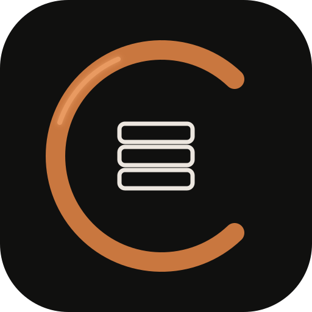

<div align="center">

  

# Cobre Server

**O centro de identidade e conexão do ecossistema Cobre.**

Aplicativo desktop para Windows · Cobre ID · Dispositivos · Diagnóstico local

[Baixar Cobre Server 1.2.0](https://github.com/bruncosta077-boop/Cobre-Server/releases/tag/v1.2.0) · [Estado dos quatro apps](docs/ESTADO-ECOSSISTEMA.md) · [Arquitetura](docs/ARQUITETURA.md) · [Roadmap](docs/roadmap.md)

</div>

---

## O que é

O Cobre Server é um **aplicativo desktop independente** que mantém os serviços locais do Cobre ID ativos e oferece uma central visual para acompanhar contas, dispositivos e estado do serviço. Ele foi desenhado para fazer parte do [Cobre Desktop](https://github.com/bruncosta077-boop/Cobre), [Mobile](https://github.com/bruncosta077-boop/Cobre-Mobile) e [TV](https://github.com/bruncosta077-boop/Cobre-TV).

Não é uma página hospedada nem um serviço de streaming de áudio. A API local coordena contas e permissões; o áudio segue diretamente do Desktop ao Mobile. Fechar a janela mantém o serviço ativo na área de notificação. Se quiser, habilite **Iniciar com o Windows** nas configurações para o serviço ficar disponível após entrar no computador.

## Créditos

Projeto de Bruno C S Moraes, com contribuições de [@dilucas00](https://github.com/dilucas00).

## Baixar o aplicativo

O Cobre Server 1.2.0 aprimora o diagnóstico de stream com medições recentes informadas pelo Mobile e pela TV. Na página da release estão o ZIP portátil, o instalador Windows e `checksums-sha256.txt`. Compare o SHA-256 do arquivo antes de abrir.

O ZIP não exige Node.js instalado. A primeira inicialização cria o banco e a chave local na pasta de dados do usuário do Windows. Leia [Segurança e dados](#seguranca-e-dados) antes de permitir conexões na rede.

## O que a central mostra

- Estado do serviço e número de contas Cobre ID.
- Endereço para informar no Mobile, seleção entre endereços da rede e ação para copiar.
- Dispositivos vinculados, tipo, plataforma, versão e último heartbeat.
- Filtros de aparelhos online/offline e busca.
- Tempo de resposta da API local e endereços/portas usados.
- Diagnóstico com taxa de áudio recebida e latência inicial informadas pelo Mobile ou TV durante stream do Desktop; só mostra amostras recentes de aparelhos online, enquanto presença e latência do catálogo permanecem métricas separadas.
- Atalho para abrir a pasta de dados e opção segura para encerrar o servidor.

O painel separa presença Cobre ID da disponibilidade da biblioteca e da reprodução. Ele mostra medidas recentes reportadas pelos clientes durante reprodução do Desktop. O Cobre Server **não retransmite músicas**; os bytes do áudio seguem diretamente do Desktop ao aparelho pela rede local.

## Como os aplicativos se conectam

```text
Cobre Desktop ───────────────► Cobre Mobile / Google TV
      │                           ▲
      └──── identidade e presença ─┤
                                  │
                           Cobre Server
```

O Cobre Server coordena contas, sessões, dispositivos e pareamento. O Desktop deve continuar sendo a origem da biblioteca; o áudio é transmitido diretamente ao aparelho na rede local. Consulte [a arquitetura detalhada](docs/ARQUITETURA.md) para limites e etapas que ainda faltam.

## Executar em desenvolvimento

Requer Node.js 22.13 ou superior.

```powershell
npm install
npm run app
```

Para criar localmente o instalador e ZIP:

```powershell
npm run dist:win
```

Os artefatos aparecem em `release/`. Para iniciar somente a API em modo de desenvolvimento: `npm start`.

## Verificação

```powershell
npm test
```

## Segurança e dados

O aplicativo escuta a API em `0.0.0.0:8080` para que os clientes da rede local possam acessá-la, mas recusa conexões cujo IP de origem não seja loopback ou uma faixa local privada. O painel administrativo usa `127.0.0.1:8788` e não é publicado na rede. Essa barreira reduz exposição acidental, mas não substitui HTTPS, firewall ou segurança do roteador. Os dados da instância ficam em `%APPDATA%\Cobre Server\data`, incluindo banco e chave de assinatura. **Não compartilhe essa pasta.** Perder a chave invalida as sessões existentes.

O serviço pode usar HTTP na rede local ou HTTPS com certificado e chave PEM configurados em **Configurações → HTTPS**. HTTPS substitui HTTP na porta da API; depois de reiniciar, atualize a URL nos aplicativos. Use um certificado válido, confiável pelos aparelhos e cujo nome/IP corresponda ao endereço usado. Certificado autoassinado não é aceito automaticamente pelos clientes. HTTPS protege o tráfego local, mas não habilita acesso pela internet: a API continua recusando origens públicas. Sem HTTPS, use somente uma rede Wi-Fi confiável. Estado “online” significa heartbeat recente; não comprova que o Desktop está acessível nem que o áudio está tocando.

Em **Configurações → Cópia de segurança**, exporte um arquivo `.cobre-backup` periodicamente. Ele contém contas, dispositivos, sessões e a chave desta instância, criptografados com AES-256-GCM e chave derivada por scrypt. Use uma senha exclusiva com pelo menos 12 caracteres e guarde o arquivo e a senha separadamente. Sem a senha, não é possível recuperar o arquivo. A restauração valida o banco, pede confirmação e salva uma cópia criptografada do estado atual junto do arquivo escolhido antes de substituir os dados e reiniciar o serviço. Limite do banco por cópia: 128 MB.

O backup não inclui músicas, capas ou dados do Desktop/Mobile/TV, nem a chave privada do certificado HTTPS. Guarde separadamente o certificado e a chave importados para HTTPS. Perder a chave de assinatura fora de um backup válido invalida as sessões existentes.

## Estrutura

| Caminho | Responsabilidade |
|---|---|
| `server.js` | API Cobre ID, autenticação, pareamento e presença |
| `electron-main.js`, `preload.js` | Janela desktop, ciclo de vida e ações locais seguras |
| `dashboard/` | Interface de gerenciamento embutida no aplicativo |
| `dashboard.js` | Servidor local do painel e endpoint de status |
| `test/` | Testes automatizados da API |
| `docs/` | Arquitetura e roadmap do ecossistema |
| `.github/workflows/` | Empacotamento Windows e publicação de artefatos |

## Licença

Este repositório não declara uma licença de redistribuição. Consulte o autor antes de reutilizar o código.
